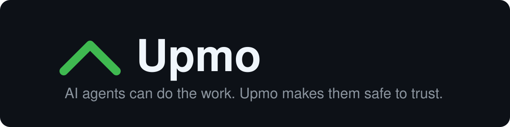

<p align="center">
  
</p>

<p align="center"><b>Open core of Upmo AI</b>: agents that do real work, with approvals, checks and a full log.</p>

<p align="center">
  <a href="#what-agents-work-with">What agents work with</a> ·
  <a href="#how-a-task-runs">How it works</a> ·
  <a href="#why-safe-to-trust">Why safe</a> ·
  <a href="#quick-start">Quick start</a> ·
  <a href="#documentation">Docs</a> ·
  <a href="#contributing">Contributing</a> ·
  <a href="#security">Security</a> ·
  <a href="https://upmo.ai">upmo.ai</a>
</p>

<p align="center">
  <a href="https://github.com/upmo-ai/upmo/actions/workflows/ci.yml"></a>
  
  
  
  
  
  <a href="LICENSE"></a>
</p>

Upmo gives your business AI agents that do real work in the tools you already use. One agent per task: invoices, payroll, support tickets, contracts, deadlines. A separate check confirms each result. Anything important waits for your approval.

This repository is the open core those guarantees are built on: a modular monolith in Go, `brain`, with a React web app and Postgres. It runs on Upmo's managed cloud at upmo.ai, or on your own servers, free. Every guarantee on the site is enforced here, in code you can read.

## What agents work with

- **Your tools.** Connectors work inside your accounts, not in a copy of them. Anything with an API can be connected.
- **Your knowledge.** Playbooks, house rules and documents, searched before agents act. Every learned fact shows where it came from. Facts are kept apart per team.
- **Clear costs.** Pick a model per agent, see the exact cost of every task, and set budgets that stop spending.

## How a task runs

```text
prepare  ->  plan  ->  work  ->  check  ->  you approve (when it matters)
```

Every task follows the same steps. A check confirms the agent delivered what was asked, not just that it says so. Rework is capped.

## Why safe to trust

| Guarantee                       | What it means                                                                                                                            |
| ------------------------------- | ---------------------------------------------------------------------------------------------------------------------------------------- |
| **Keys stay hidden**            | Agents hold stand-in keys. Upmo adds the real key on the way out, only for services on the task's list. Agents never see your passwords. |
| **You give the final approval** | Payments, emails to customers and record changes wait for you.                                                                           |
| **Work is checked**             | Every result is checked against the plan and the goal before it counts as done.                                                          |
| **Least access per task**       | Each task gets a short list of tools, a stand-in key and a budget. Requests to unknown sites are blocked.                                |
| **Everything is logged**        | Every read, write and sent email lands in the log with the time, the cost and the source.                                                |
| **Your data stays yours**       | Each team sees only its own data. Sign in with a passkey.                                                                                |

## Choose how to run it

| | Managed cloud | Self-host |
| --- | --- | --- |
| Where | Upmo's cloud | Your own servers |
| You run | Nothing | Docker, Postgres, backups |
| Start | [upmo.ai](https://upmo.ai) | [upmo.dev](https://upmo.dev) |

## Quick start

You need Docker and nothing else.

```sh
make up               # start the worker, brain and postgres, brain listens on localhost:8080
curl -fsS localhost:8080/healthz
make down
```

## Documentation

| Guide | What it covers |
| --- | --- |
| [Installation](docs/installation.md) | Run Upmo locally with Docker |
| [Configuration](docs/configuration.md) | Environment variables and ports |
| [Operations](docs/operations/README.md) | Services, backup and restore, key rotation, version endpoint |
| [Data at rest](docs/operations/data-at-rest.md) | What Upmo protects on disk and what the host must provide |
| [Security](docs/security.md) | How Upmo limits agents and protects data |
| [Development](docs/development.md) | Build, test and code layout |

## Contributing

Contributions are welcome. Read [CONTRIBUTING.md](CONTRIBUTING.md) and the [Code of Conduct](CODE_OF_CONDUCT.md) before you open an issue or a pull request. Setup, tests and code layout are in [docs/development.md](docs/development.md).

## Security

Do not open a public issue for a security problem. Email **security@upmo.ai**. The [security policy](SECURITY.md) says what to include and how fast we reply. For how Upmo protects your data, see [docs/security.md](docs/security.md).

## Getting help

Open a [GitHub issue](https://github.com/upmo-ai/upmo/issues) for questions and problems.

## License and trademark

Upmo AI is a product of Klassroom.

Code and documentation are under the [GNU Affero General Public License v3.0](LICENSE) (`AGPL-3.0-only`).

The Upmo name, caret mark and wordmark are not under that license. See [TRADEMARK.md](TRADEMARK.md).

Third-party fonts and other assets, with their licenses, are listed in [THIRD_PARTY_NOTICES.md](THIRD_PARTY_NOTICES.md).
